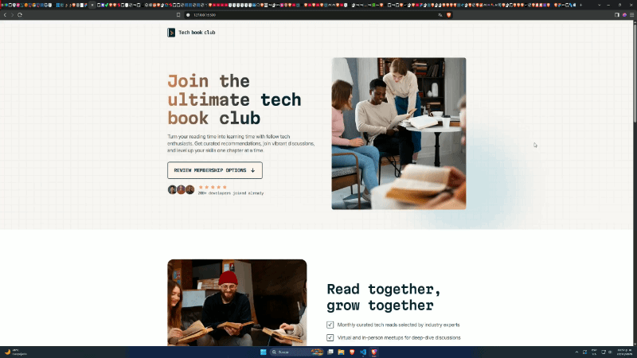

# Frontend Mentor - Tech book club landing page solution

This is a solution to the [Tech book club landing page challenge on Frontend Mentor](https://www.frontendmentor.io/challenges/tech-book-club-landing-page-fZQidjHU73).

[Live Site Demo](https://quirozdev.github.io/tech-book-club-landing-page/)

Demo

## Table of contents

- [Overview](#overview)
  - [The challenge](#the-challenge)
  - [Links](#links)
- [My process](#my-process)
  - [Built with](#built-with)
- [Author](#author)

## Overview

### The challenge

Users should be able to:

- View the optimal layout for the interface depending on their device's screen size
- See hover and focus states for all interactive elements on the page

### Links

- <a href="https://github.com/Quirozdev/tech-book-club-landing-page" target="_blank">Solution URL</a>
- <a href="https://quirozdev.github.io/tech-book-club-landing-page/" target="_blank">Live Site URL</a>

## My process

### Built with

- Semantic HTML5 markup
- CSS custom properties
- Flexbox
- CSS Grid
- Mobile-first workflow
- Vanilla HTML, CSS and JavaScript

## Author

- GitHub - <a href="https://github.com/Quirozdev" target="_blank">Quirozdev</a>
